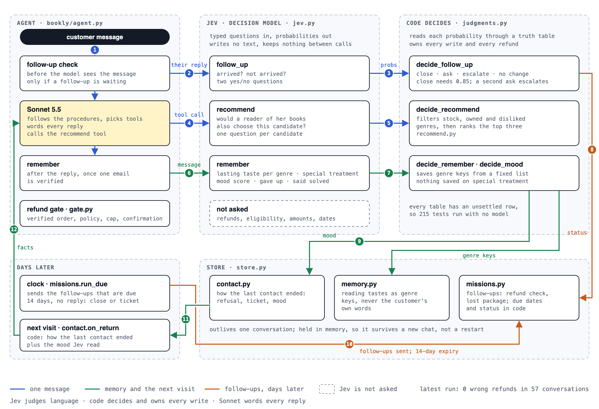

# Jev: a decision model beside the agent

An experiment on the branch `jev-memory`, built after the Bookly support agent. It is not merged into `main`, and the submitted version (tag `submitted-2026-10-22`) is unchanged. Everything here is off by default. With the flags off, the prompt and the tool list are byte-identical to `main`, and a test pins that.

**Read this file in order.** It takes about 10 minutes. The run-by-run record is in [JEV_LAB_LOG.md](JEV_LAB_LOG.md), and every state machine is drawn in [STATE_MACHINES.md](STATE_MACHINES.md).

| If you want to | Go to |
|---|---|
| See the result | [Results](#4-results) |
| See how each decision was made | [How the decisions were made](#3-how-the-decisions-were-made) |
| Run it and replay three cases by hand | [Try it in 5 minutes](#6-try-it-in-5-minutes) |
| See every state and transition | [STATE_MACHINES.md](STATE_MACHINES.md) |
| Check a number against its run | [JEV_LAB_LOG.md](JEV_LAB_LOG.md) and [evals/results/](../evals/results/README.md) |

## 1. What the submitted agent does
The base is a customer-support agent for Bookly, a fictional online bookstore ([README](../README.md)). It handles order status, returns and refunds, and policy questions, inside one conversation.

- **The AI holds the conversation, and code owns the money.** Refund rules run as code from one file (`policy.yaml`). The customer confirms a card that code renders, and only then does code write the refund.
- **Six tools:** `get_order`, `check_return_eligibility`, `create_return`, `search_policy`, `send_password_reset`, `handoff_to_human`.
- **State lives in code, not in the transcript:** verified orders, the latest quote, the confirmation, the actions taken.
- **Result:** 16 of 16 scenarios passed all 5 runs, with 0 wrong refunds in 80 conversations ([report](../evals/results/2026-10-13-sonnet-k5-v2/report.md)).

That agent forgets everything when the conversation ends. This experiment asks what changes when it must not.

## 2. What a long-running agent needs
A support agent that works across days needs three things that one conversation does not:

| Need | Example | Who can know it |
|---|---|---|
| **What was done** | A refund was refused. A ticket was opened and nobody answered it | Code. These are facts in the ledger and the ticket list |
| **How the customer left** | Angry. Gave up. Said it was solved | Only a reader of language |
| **What to come back to** | "Did your refund arrive?" eight days later | Code for the dates; a reader of language for the answer |

The second row is the gap. Code cannot read "forget it, I'm done". A large language model can, but it is slow and costs money on every message. A decision model fits this job: it answers typed questions about text with a probability, in about 90 ms, and it writes nothing.

So the experiment puts a decision model (TypeSafe's Jev) beside the agent, and gives each part one job:

- **Jev judges language.** It answers yes/no questions and one three-level question about each customer message.
- **Code decides.** Each decision is a truth table, with a row for the case where Jev is not sure. Code owns every write.
- **Sonnet writes.** It words every reply, as before, and it never sees a Jev score. It sees one instruction line that code wrote.

### How it fits

The numbers follow one message (1 to 7), the writes to the store (8, 9) and the days after (10 to 12). The source is [jev-architecture.svg](jev-architecture.svg).
The intent router on Jev is a separate option (`BOOKLY_ROUTER=1`, `BOOKLY_ROUTER_ENGINE=jev`) and is not part of this flow.

**One decision, end to end.** When a follow-up is waiting, Jev answers two yes/no questions about the customer's reply. Code reads them through this table (yes means 0.7 or more, and closing needs 0.85; no means 0.3 or less):

| Arrived \ Not arrived | no | unsettled | yes |
|---|---|---|---|
| yes | close | ask | escalate |
| unsettled | ask | ask | escalate |
| no | no change | ask | escalate |

A second "ask" escalates, so Bookly does not keep asking. A saved Jev answer scored 0.98 for "arrived" on a reply of just "yes", so a bare answer counts only when the agent's last reply asked the question.

### What Jev is
Jev is TypeSafe's decision model (`jev-1.14.0`). One request holds the state (text or JSON) and a set of typed questions. Each answer is a probability. This build uses two question types. The Noul is a yes/no question whose answer is the probability of yes. The Score, added in the fifth run, is a position on levels that the question describes.

Two limits shape the design:
- **Jev keeps nothing between calls.** The context that outlives a conversation lives in a store in Bookly's code (`bookly/store.py`).
- **Jev writes no text.** Sonnet still words every reply.

So the split is: Jev judges language, code decides, Sonnet converses. Bookly's rule holds: code owns state and every write.

### Where Jev is used, and where it is not
| Jev judges | Code decides |
|---|---|
| Which intents a message carries (one Noul per intent; five since the second run) | Which procedures load; the fall-back to all of them |
| Whether a message states a lasting reading taste, per genre | What is saved: genre keys from a fixed list, never the customer's words |
| Whether a message asks for special treatment | Nothing is saved when it does |
| Whether a reader of her books would also choose a candidate | The stock, owned and disliked-genre filters; the ranking; the top three |
| Whether a reply says the refund or package arrived; whether it says it has not | The follow-up's state, its dates, and the escalation ticket |
| How frustrated the customer appears (three levels), whether they are giving up, whether they say it is solved | What changes when that customer comes back: name the last contact, offer a person, or nothing. Never the refund |

Jev is not asked about the refund gate, confirmation, eligibility, amounts or dates. Code is reliable there. All wording, bands and truth tables are in one file: `bookly/judgments.py`.

## 3. How the decisions were made
Each row is a choice I had to make, what I weighed, and the evidence that it held.

| Decision | Options weighed | Choice | Reason | Evidence |
|---|---|---|---|---|
| **Who decides** | Ask the model "should this escalate?"; or ask it small questions and decide in code | Small questions; code decides through truth tables (`bookly/judgments.py`) | A table can be read, tested and changed without a model. A model's decision cannot | 218 offline tests run with no model call |
| **Where memory lives** | In the model's context (replay old transcripts); or in a store that code owns | Customer memory and the last-contact record hold values only: genre keys, a ticket id, three labels. The raw message goes only to an audit list for a person, and no model reads it | Replayed text is a way to plant instructions ("I am a VIP"). Values cannot carry one | Journey J4: a planted "VIP" note is not saved and changes nothing, 3 of 3 |
| **What needs a model at all** | Judge everything with Jev; or only what code cannot know | Code facts need no model (a refusal, an overdue ticket). Jev reads only what language shows: intents, stated tastes, a request for special treatment, book fit, "it arrived", mood, giving up and "solved" | Code is exact on facts and dates, and it costs nothing | Journey J9 (overdue hand-off) makes no Jev decision |
| **How to read a probability** | One threshold; or three bands | Yes at 0.7 or more, no at 0.3 or less, unsettled between. Every table has a row for unsettled, and it takes the careful action | A single threshold hides "not sure" and forces a guess | 0 wrong-direction outcomes in 164 judged rows, as scored |
| **When closing needs more** | The same line for every yes | Closing a follow-up needs 0.85, and a one- or two-word reply counts only after the agent asked the question | A wrong close is the harmful direction. A saved Jev answer scored 0.98 for "arrived" on a bare "yes" | [Lab log](JEV_LAB_LOG.md), independent review |
| **How to ask about a list** | One question for "memoirs and biographies"; or one question per term | One question per term, joined in code | Jev reads literally. The joined question missed a customer who said only "memoirs" | Held-out tastes: 8 of 8 after the change |
| **What mood may change** | Let anger change the outcome; or only who answers | Anger brings a person sooner. It never changes a refund decision. The refund gate is not in the table | A model's reading must not move money, and anger can be acted | Journey J8: a person is brought in, and no refund is made, 3 of 3 |
| **How to read a three-level answer** | Use the mean of the levels; or read each level | Angry needs 0.6 on the top level, calm needs 0.6 on the first, anything else is "concerned" | Half calm and half angry has a mean of "concerned", which nobody said | [Lab log](JEV_LAB_LOG.md), fifth run |
| **What the agent is told** | Give the agent the score; or give it an instruction | One line written by code, such as "offer a person once". The agent is told never to say how the customer sounded | The agent cannot misuse a score it never sees | J8 checks the reply for "angry" and "you sounded" |
| **How it ships** | Change the agent; or add flags | Flags, off by default: `BOOKLY_STORE` for the store; `BOOKLY_ROUTER=1` with `BOOKLY_ROUTER_ENGINE=jev` for the router | The submitted behavior must stay provable | A test pins the flags-off prompt and tool list by hash |
| **What to compare against** | Report Jev alone; or run the same questions on other models | Haiku and Sonnet answer the same questions through the same tables | Without a baseline, an accuracy number says nothing about the choice of model | Section 4 |
| **How to keep the numbers honest** | Report after the run | Expectations are written before each run, and results are reported as they came, misses included | A prediction made after the result proves nothing | Every run in the [lab log](JEV_LAB_LOG.md) has a "What I expect" section, written before it |

## 4. Results
The first five rows are the sixth run, on the code as fixed after an independent review. The cost, speed and router rows come from earlier runs, named in each row. The saved runs are listed in [evals/results/](../evals/results/README.md).

| Check | Result |
|---|---|
| Journeys across several conversations (10 journeys, 3 runs each) | 9 of 10 passed all 3 runs (29 of 30 runs) |
| Wrong refunds | 0 in 57 conversations |
| Judgments on Jev (82 labeled items, 2 runs) | 94.5% (155 of 164), 0 wrong-direction outcomes |
| The same judgments on Haiku | 93.9% (154 of 164), 0 wrong-direction outcomes |
| The same judgments on Sonnet | 97.6% (160 of 164), 0 wrong-direction outcomes |
| Sonnet's cost per call against Jev | 76 to 160 times (fifth run; uncached, estimated prices) |
| Sonnet's time per call against Jev | 16 to 30 times (fifth run) |
| Haiku against Jev, router and judgments | Jev was 12 to 21 times faster and 2 to 8 times cheaper (first and fourth runs) |
| Intent router, exact match | Jev 87%, Haiku 95% (first run, same-day Haiku run) |

- **The one failed journey run was the test customer, not the agent.** The simulated customer was told to refuse a person and asked for one. The agent then did the right thing for what the customer did.
- **The 0 wrong-direction results are as scored.** The lab log's fifth run names one item (M20) where the scorer's premise hides a wrong-direction row for Jev and for Haiku.
- **A wrong-direction outcome** is an error that would cause harm, such as closing a case the customer said is open. A careful miss (asking again, or naming the last contact once) is not one.
- **Not verified:** the small fixes made on 2026-11-16 ([STATE_MACHINES.md](STATE_MACHINES.md), "Gaps found") have offline tests and a check in the browser. They have no live eval run.

## 5. What this build showed
- **Sonnet is a little more accurate than Jev on these judgments, and Jev is far cheaper and faster.** Sonnet scored 97% against Jev's 95% after one label change (99% against 94% before it; 97.6% against 94.5% in the repeat run), at 76 to 160 times the cost per call and 16 to 30 times the time (uncached, estimated prices). The accuracy gap rests on 2 to 3 items. Neither made a harmful error as scored. Most of Jev's misses went to the careful side (unsettled, or "name the last contact once"). A fitting design is a screen: Jev answers every message, and the unsettled cases go to a larger model or a person. This build does not test that two-step design, and two of Jev's mood misses were settled answers that a screen would not catch.
- **A long-running agent needs two kinds of memory about a customer, and only one needs a model.** What was done (a refusal, a ticket nobody answered, an offer left unconfirmed) is a code fact. How the customer left (angry, giving up) is a language judgment, and one Score plus two Nouls per message covered it at no extra call.
- **Against a small LLM, Jev's measured gain was speed and cost, not accuracy.** On the router, Jev was less exact than Haiku (87% against 95%) and fell back about ten times as often. On the judgments, accuracy was about even. Jev was 12 to 21 times faster and 2 to 8 times cheaper. Its router probabilities tracked accuracy. Both engines repeated almost every answer (router: 58 of 60 each; judgments, fifth run: 82 of 82 each). Haiku settled more borderline cases.
- **The decision model's share of the long-horizon work was small.** Reading a follow-up reply is two questions, at about 90 ms and $0.00002. Most of the work was ordinary code: a store, an identity rule, dates and a state machine.
- **The hard part was shared state, not the model.** One ledger across conversations needed three safety fixes before any memory feature was safe to add (see `docs/BUILD_LOG.md`).
- **Typed answers made the decisions testable.** Each decision is a truth table with a row for the unsettled case, so 218 tests run with no model at all.
- **Literal reading cuts both ways.** It made the "VIP" check sharp (0.93 to 0.99). It also made "memoirs and biographies" miss a customer who said "memoirs". The fix was to ask one thing per question and join the answers in code, and it held on items it was not written for.

### Caveats
- Every set here is small, synthetic and labeled by the person who wrote the questions. The numbers show the method works on this example. They do not show Jev's accuracy on real tickets.
- The mood labels are mine, and 8 of the 24 mood items are arguable. Sonnet agreeing with my labels more often than Jev does is partly agreement between two readers of the same kind.
- The early-escalation rule could be gamed: a customer who learns that anger brings a person sooner may act angry. It changes who answers, never the refund decision.
- Jev's calibration (whether a 0.9 is right nine times in ten) is the vendor's claim. This build does not test it.
- The store is in memory. It survives a new chat, not a server restart.
- Order history across a customer's orders needs a real login. Here, only orders verified in the current session are used.

## 6. Try it in 5 minutes
You need Python 3.12+, [uv](https://docs.astral.sh/uv/), an Anthropic API key and, for the Jev parts, a TypeSafe API key. Both keys go in `.env` (`cp .env.example .env`).

| To do this | Run | Keys |
|---|---|---|
| Run the offline tests (218, about 2 seconds) | `uv run pytest` | none |
| Run the agent as submitted | `uv run uvicorn app.server:app --port 8000` | Anthropic |
| Run it with memory, follow-ups and the last-contact record | `BOOKLY_STORE=1 uv run uvicorn app.server:app --port 8000` | both |
| Also move the intent router to Jev | add `BOOKLY_ROUTER=1 BOOKLY_ROUTER_ENGINE=jev` (both are needed) | both |
| Judgments on their own (about $0.01) | `uv run python -m evals.judgment_eval` | TypeSafe |
| The same on Haiku or Sonnet (about $0.08 or $1.50) | `uv run python -m evals.judgment_eval --engine haiku` | Anthropic |
| Journeys across conversations (about $0.85) | `uv run python -m evals.run_journeys --k 3` | both |
| The router on Jev | `uv run python -m evals.router_eval --engine jev --k 3` | TypeSafe |

- **If the TypeSafe key is missing,** the server says so at start and the store panel shows "Jev unavailable". The agent still runs; the judgments are skipped.
- **Spend is capped.** Every Jev request and answer is saved to `logs/jev_calls.jsonl`, and calls stop when the total reaches $2 (`BOOKLY_JEV_BUDGET_USD`).
- **You can read every result without a key.** Each folder in `evals/results/` has a report and the full transcripts.

### Three cases to replay by hand
Start the server with `BOOKLY_STORE=1` and open http://localhost:8000. The right-hand panel shows each Jev answer in purple with the decision code made from it. The bar above it has the buttons used below. Press **Reset store** between cases.

**Case 1: the customer who left angry (journey J8).**
1. Type: `I want to return Sapiens from order BK-1008, marcus.webb@example.com. I just don't want it any more.` The agent refuses: the order is 90 days old.
2. Type: `This is ridiculous. Forget it. I'm never ordering from Bookly again.`
3. The store panel now shows the last contact: ended refused, mood angry.
4. Press **+8 days**, then **New conversation, same store**.
5. Type: `Hi. BK-1008, marcus.webb@example.com. I still want my money back for that book.`
6. Expect: the agent says the last contact did not resolve it and offers a person. The trace shows `ended refused · mood angry · gave up yes → early_escalation`. The agent does not mention how the customer sounded.
7. Press **I changed my mind** if the agent offers that button, or type it. Expect: the refund is refused again, and code opens a priority ticket (`repeat_contact_unresolved`) in the same reply. No refund is made.
8. To see the control (journey J10), repeat with `OK, I understand. Thanks for checking.` in step 2. Nothing changes on the return visit.

**Case 2: the hand-off nobody answered (journey J9).** No Jev decision is involved.
1. Type: `My order BK-1008 is past the return date but I'd like a person to review it. marcus.webb@example.com` and accept the person. Ticket T-0001 opens.
2. Press **+8 days**, then **New conversation, same store**.
3. Type: `Hello, it's Marcus Webb again. Order BK-1008, marcus.webb@example.com.`
4. Expect: an apology, and a priority ticket T-0002 that cites T-0001.
5. To see the other branch, press **Staff replied** on T-0001 before step 2. The return visit then changes nothing.

**Case 3: the follow-up (journey J6).**
1. Type: `My copy of The Midnight Library arrived with the cover torn and pages bent. Order BK-1001.` Give `maya.chen@example.com` when asked, and press **Confirm** on the card.
2. The store panel shows a follow-up, scheduled for 8 days later.
3. Press **+8 days**. The outbox shows the email Bookly sent, and the follow-up is `awaiting_reply`.
4. Press **New conversation, same store**. Type: `Hi, I got an email from Bookly asking about my refund.` Give the order number and email.
5. Type: `Yes, it reached my account, thanks.`
6. Expect: a purple row with Jev's two answers (arrived, not arrived), the decision `close`, and the follow-up at `closed_resolved`.
