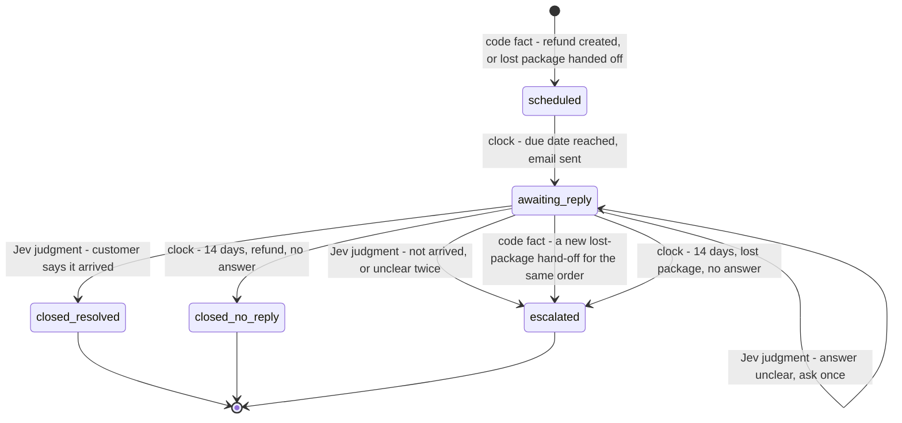
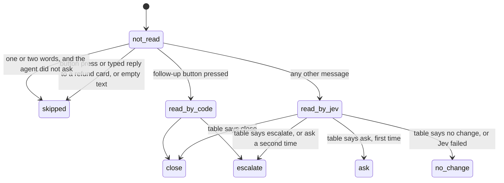
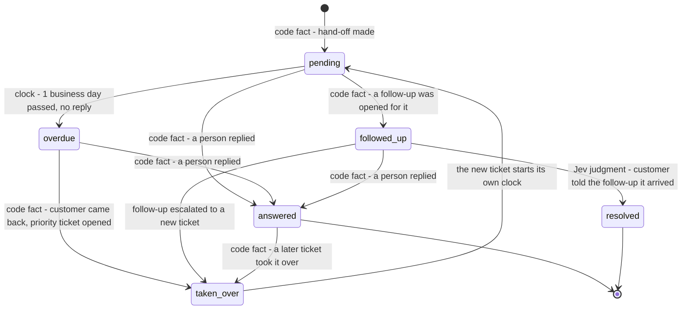
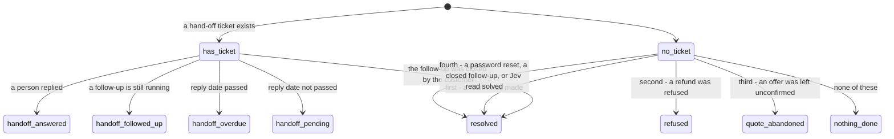
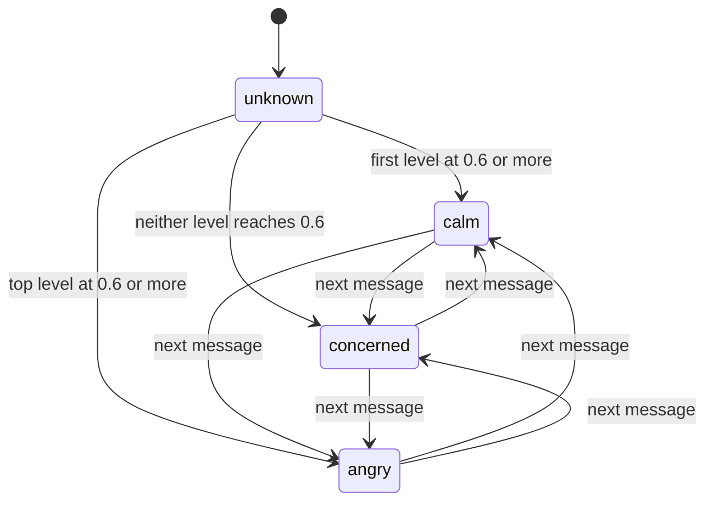
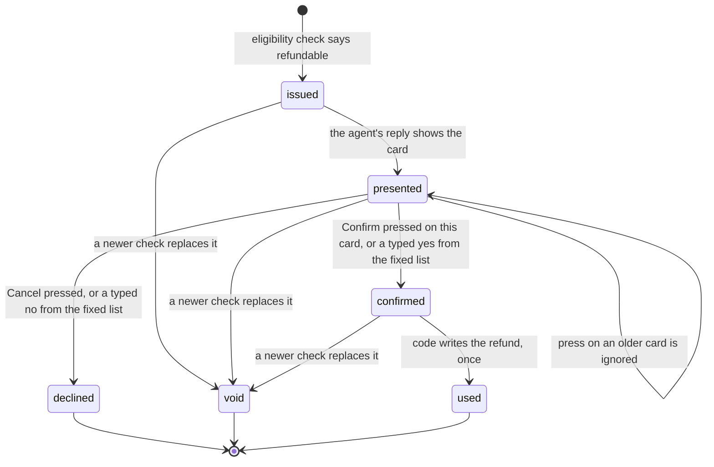
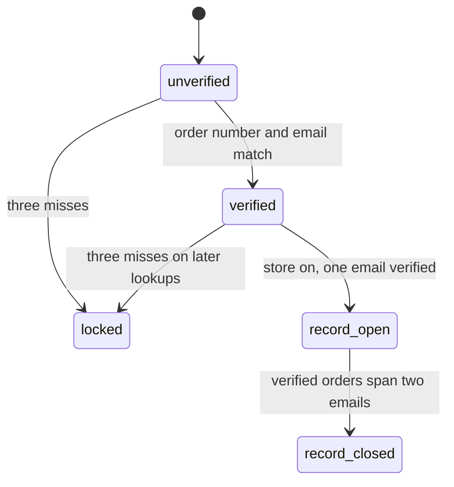
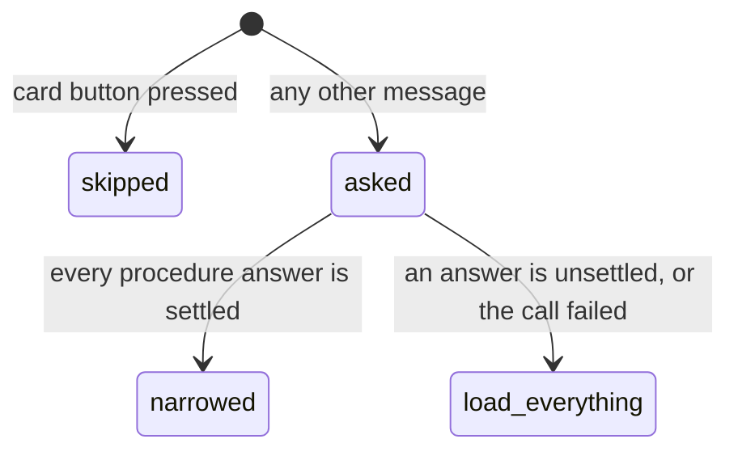
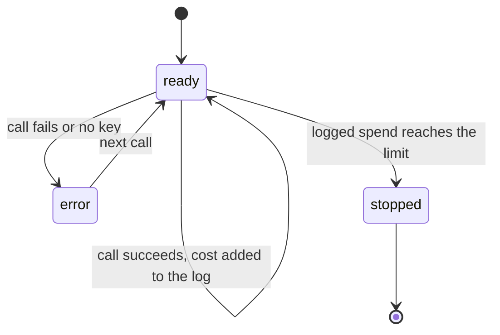
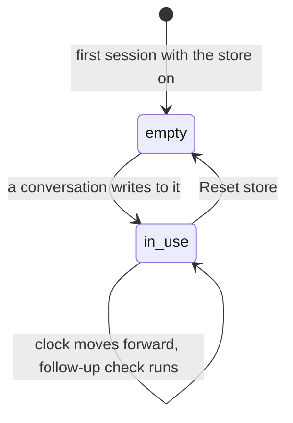

# The state machines in this build

A state machine is a thing that is in exactly one state at a time and moves between states on named events. A long-running support agent is mostly state machines: a follow-up waits, a ticket goes overdue, a refund offer is confirmed or left.

This file draws the ten main state machines in the build, the submitted agent's included. Three small ones are named at the end and not drawn. For each one it says who triggers each move: **the clock**, **a code fact**, or **a Jev judgment**. That split is the main design decision of the experiment ([JEV.md](JEV.md), section 3).

**Read this first: most of these machines are implicit in the code.** Their states are plain strings, and the moves are spread over `if` chains in more than one file. No machine has one declared table of allowed moves. I found that by reviewing the build for exactly this, on 2026-11-16. The review also found gaps, listed at the end with what was fixed and what was left. I did not rewrite the machines into explicit tables: that would change code that six live runs checked, and the saved runs would no longer match the code. "What I would make explicit first" says what I would do next and why.

| # | Machine | Runs when | Moves triggered by | Explicit in code? |
|---|---|---|---|---|
| 1 | Follow-up lifecycle | store on | clock, Jev judgment, code fact | States in a docstring; three writers in 2 files |
| 2 | Reading a follow-up reply | store on | Jev judgment, button press | Truth table is explicit; the guards are not |
| 3 | Hand-off ticket | store on | clock, code fact | No. The state is worked out from dates on each read |
| 4 | How the last contact ended, and what happens on return | store on | code fact, Jev judgment | Truth table is explicit; the ending is an `if` chain |
| 5 | Mood labels | store on | Jev judgment | Thresholds are constants; the labels are strings |
| 6 | Refund quote and confirmation card | always | code fact, button press, a typed yes or no from a fixed list | No. Three fields together make the state |
| 7 | Identity and the customer record | always (record: store on) | code fact | No |
| 8 | Intent router fall-back | router on | Jev or Haiku answer | One function (`Route.to_load`) |
| 9 | Jev budget and errors | any Jev call | code fact | One class (`bookly/jev.py`) |
| 10 | Shared store and clock | store on | button press | One module (`app/server.py`) |

Machines 6 and 7 are the submitted agent. They are drawn here because the new machines read them, and they are not changed.

---

## 1. Follow-up lifecycle
A follow-up is a case that Bookly comes back to after the conversation ended. Code opens one when a refund is created (`refund_check`) or when a lost package is handed to a person (`lost_package_check`).

- **Where:** `bookly/missions.py` (`Mission.status`, `Missions.run_due`, the function `read_reply`), and one more writer in `bookly/tools.py` (`Toolbox._after_handoff`).
- **Dates are code.** A refund follow-up is due 5 business days plus 2 days after the refund. An unanswered one expires after 14 days.
- **Why the two expiry moves differ:** no answer about money that was sent closes quietly. No answer about a package that never came goes to a person.
- **What the agent is told:** one line from `Mission.next_step`, only for a follow-up that awaits a reply or that this conversation touched. A new conversation is told nothing about a follow-up that is scheduled, closed or escalated.
- **Tests:** the follow-up tests in `tests/test_store.py`, `tests/test_contact.py`, journeys J6 and J7.

## 2. Reading a follow-up reply
Two yes/no questions go to Jev: does the reply say it arrived, and does it say it has not arrived. Code reads both answers through this table (`judgments.decide_follow_up`). Yes means 0.7 or more, and "arrived" needs 0.85 to close. No means 0.3 or less.

| Arrived \ Not arrived | no | unsettled | yes |
|---|---|---|---|
| **yes** | close | ask | escalate |
| **unsettled** | ask | ask | escalate |
| **no** | no change | ask | escalate |

- **Where:** `Agent._read_follow_up_replies` in `bookly/agent.py` (before the model sees the message) and `Toolbox._customer_record` in `bookly/tools.py` (at verification, over earlier messages).
- **Why the one-or-two-word guard exists:** a saved Jev answer scored 0.98 for "arrived" on a bare "yes". A bare "yes" to a different question must not close a case.
- **A Jev failure is never an answer.** It leaves the follow-up as it was and shows in the trace as unavailable.
- **Tests:** `test_an_unclear_answer_asks_once_then_escalates`, `test_a_bare_yes_is_read_only_after_the_agent_asked`, the 9-cell table test in `tests/test_jev.py`.

## 3. Hand-off ticket
A ticket has no status field. Its state is worked out on every read from two dates, one link and the follow-ups that point at it.

- **Where:** `bookly/contact.py` (`live_ticket`, `ended`, `reply_due_on`); fields on `Ticket` in `bookly/backend.py` (`opened_on`, `answered_on`, `escalated_to`).
- **"Overdue" is never stored.** The same ticket reads `pending` one day and `overdue` the next. That is why the check runs when the customer returns, not when the conversation ends.
- **A later ticket wins.** If a ticket is both answered and taken over, the newer ticket's state is the one that counts.
- **One ticket per case.** A later request in the same conversation is added to the open ticket. An unanswered ticket is carried into the customer's next record, so a visit in between does not lose it.
- **Tests:** `tests/test_contact.py` (overdue, answered, closed by follow-up, later request, hand-off before verification), journey J9.

## 4. How the last contact ended, and what happens on return
When a verified customer comes back, code works out how the last contact ended, in this order of precedence. Every input is a code fact except one: "the customer said it is solved" is a Jev judgment.

Then one table (`judgments.decide_return_contact`) joins that fact with the two things only language shows:

| How it ended (code) | Mood, gave up (Jev) | Outcome | What the customer sees |
|---|---|---|---|
| `handoff_overdue` | any | `priority_handoff` | An apology and a priority ticket that cites the old one. No Jev decision |
| `handoff_pending` | any | `pending_ticket` | When a person will reply. No second ticket |
| `handoff_followed_up` | any | `none` | Nothing. The follow-up owns the case |
| `handoff_answered`, `resolved` | any | `none` | Nothing |
| `refused`, `quote_abandoned`, `nothing_done` | angry, or gave up | `early_escalation` | The agent names the last contact and offers a person. Code hands off at the next refusal |
| same | concerned, or unsettled | `acknowledge` | The agent names the last contact once |
| same | calm or unknown | `none` | Nothing |

- **Where:** `bookly/contact.py` (`ended`, `on_return`), `bookly/judgments.py` (`ENDED`, `decide_return_contact`).
- **The refund gate is not in this table.** Mood changes who answers. It never changes what the policy allows.
- **It runs once per conversation,** when the first order is verified.
- **Tests:** a test over all 8 × 4 × 4 input combinations, `tests/test_contact.py` scenarios, journeys J8, J9 and J10.

## 5. Mood labels
Three questions ride in the request that already goes to Jev for each customer message, so they add no call.

- **Mood** is the label at the customer's latest judged message. **Gave up** stays "yes" once it is "yes". **Said solved** is the latest value.
- **Where:** `judgments.decide_mood`, `Contacts.record_mood` in `bookly/contact.py`.
- **The record holds labels only,** never the customer's words.
- **Tests:** `test_decide_mood_reads_levels_not_the_mean`, the 24 mood items in `evals/judgment_set.yaml`.

---

## 6. Refund quote and confirmation card (the submitted agent, unchanged)

- **Where:** `bookly/state.py` (`Quote`: `status`, `confirmation`, `presented`), `bookly/gate.py`.
- **Only code moves this machine, and the model cannot confirm.** The customer confirms by pressing the button on the card, or by typing a whole message that is on a fixed list of yes phrases (`bookly/gate.py`). No other customer text can release money: "ok" and "sure" are left off the list on purpose, and anything else is asked again.
- **Read by the new work:** an offer left at `presented` makes the last contact end as `quote_abandoned`.
- **Tests:** `tests/test_gate.py`, `tests/test_agent_loop.py`.

## 7. Identity and the customer record (identity: the submitted agent, unchanged)

- **Where:** `Toolbox._t_get_order` in `bookly/tools.py`, `session_email` in `bookly/store.py`.
- **Nothing is judged or saved before verification.** Messages wait, and they are judged once an email is verified.
- **Tests:** `test_lookups_lock_after_repeated_misses_even_with_the_right_email`, `test_the_record_closes_when_verified_orders_span_two_emails`, `test_nothing_is_judged_before_verification_and_earlier_messages_are_judged_after`.

## 8. Intent router fall-back

- **Where:** `Route.to_load` in `bookly/router.py`, `bookly/jev_router.py`, `Agent._route` in `bookly/agent.py`.
- **The safe default is to load every procedure.** A wrong narrow answer could hide the returns procedure; loading everything only costs tokens.

## 9. Jev budget and errors

- **Where:** `bookly/jev.py`. Every caller treats an error as "no answer", never as "no".

## 10. Shared store and clock

- **Where:** `app/server.py`. One lock covers each turn and each clock move. The clock only moves forward.

---

## Gaps found
| Gap | Status |
|---|---|
| After the clock escalated a follow-up, the agent's instruction read "tell the customer exactly this: None". Reachable when the clock moves during a conversation that already touched the follow-up | **Fixed** 2026-11-16, with a test |
| A follow-up closed for no reply had no instruction, and the agent was told it was "scheduled" | **Fixed** 2026-11-16, with a test |
| The phrases the agent is given for each ending covered 3 of 8 endings. A change to the table could raise an error inside `get_order` | **Fixed** 2026-11-16: all 8 are covered, and a test asserts it |
| With the store on and no TypeSafe key, the demo ran and Jev was never called. The only sign was a row per call in the trace | **Fixed** 2026-11-16: a line at server start, and a notice in the store panel |
| `BOOKLY_ROUTER_ENGINE=jev` without `BOOKLY_ROUTER=1` did nothing, silently | **Fixed** 2026-11-16: a line at server start |
| "Jev was unavailable" and "the answer was no" share the outcome `no_change`. At verification, both stop the earlier messages from being read again; later messages are still read | Open |
| A ticket that is both answered and taken over follows the newer ticket. The rule was in code only | Open in code, now written in section 3 |
| A quote that was confirmed and never used reads as `nothing_done`, not `quote_abandoned` | Open |
| A conversation with one return and one refusal reads as `resolved` | Open |
| The test over all inputs of the return table repeats the function's logic. A written table would be a stronger check | Open |
| `Missions.open_for` and the `OPEN` tuple are not used | Open |
| The same event has three names in the quote machine: button `cancel`, signal `decline`, state `declined` | Open. It is the submitted agent, so it is left as it is |

The fixes have offline tests and a check in the browser. They have no live eval run.

## What I would make explicit first
In order of clarity gained for risk taken. All five run only with the store on.

1. **Follow-up lifecycle.** One status type, one table of allowed moves, and one function that all three writers call. This removes the chance of a state with no instruction.
2. **The ending and the return outcome.** Both become types. The test becomes a written table.
3. **Ticket state.** One function returns the state from a ticket, the follow-ups and today's date. The stored fields stay as they are.
4. **Reply outcome.** A separate value for "Jev unavailable".
5. **Mood labels.** Constant sets that include "unknown".

**Left alone on purpose:** the quote card and identity. They run with the flags off, and the quote's state names go into the text the model reads each turn. The flags-off test pins the prompt and the tool list, not that text, so a rename would change the submitted agent without a failing test. The one-ticket-per-conversation rule and the router's fall-back are shared with the base agent and the Haiku router, so they are left as well.

## Small machines, named and not drawn
- **The early-escalation flag.** Set when a customer returns after an angry or given-up ending (`bookly/contact.py`). It fires once, at the next refusal, and code opens the priority ticket (`bookly/tools.py`).
- **The needs-input counter.** Code counts unanswered asks for the same field. After two, the tool tells the agent to offer a person (`bookly/tools.py`). This is the submitted agent.
- **Likes and dislikes in customer memory.** A genre moves between liked, disliked and absent as the customer states tastes (`bookly/memory.py`).
